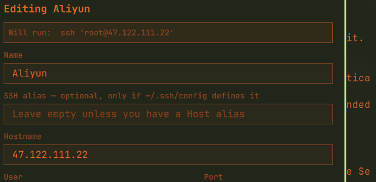

# SSHDrops

Saved SSH hosts in the Omarchy bar. Type to filter, `Enter` to connect, and
see which machines you already have a session open on.

One icon in the top bar, one panel, no separate app.



## Requirements

- Omarchy, with its Quickshell-based shell — this is a bar widget.
- An OpenSSH **client**: `ssh`, and `ssh-copy-id` for the one-time
  passwordless setup.
- `xdg-terminal-exec` (with `uwsm-app`), which Omarchy uses to open the
  connection in a terminal. `omarchy-notification-send` is used for the
  failure notification when it is present.

No `sudo` is required. SSHDrops never reads or writes `~/.ssh/config` and
never handles key material.

## Install

```bash
omarchy plugin add https://github.com/FlyingBassHot/omarchy-sshdrops.git --enable
```

Or, from a checkout:

```bash
cp -r omarchy-sshdrops ~/.config/omarchy/plugins/io.github.flyingbasshot.sshdrops
omarchy-shell shell rescanPlugins
omarchy plugin enable io.github.flyingbasshot.sshdrops
```

Then place it wherever you want it in the bar:

```bash
omarchy bar move io.github.flyingbasshot.sshdrops --section right
```

## Uninstall

```bash
omarchy plugin remove io.github.flyingbasshot.sshdrops
```

That removes the plugin and its bar placement. Your saved host library at
`~/.local/state/omarchy/sshdrops/hosts.json` is left in place — delete that
file by hand if you want it gone too. `~/.ssh/config` and your keys are never
touched, so removing the plugin cannot break an existing ssh setup.

## Using it

Click the bar icon (or press your shortcut, see below) to open the panel.

| Key            | Action                                     |
| -------------- | ------------------------------------------ |
| `↑` `↓` `j` `k` | Move the cursor                           |
| `Enter`        | Connect to the selected host               |
| `/`            | Filter the host list                       |
| `A`            | Add a host                                 |
| `E`            | Edit the selected host                     |
| `X`            | Remove the selected host (asks first)      |
| `R`            | Rescan for live sessions                   |
| `K`            | Deploy your SSH key to the selected host   |
| `I`            | Import `Host` aliases from `~/.ssh/config` |
| `Esc`          | Close the panel, step out of a form/confirm, or clear the filter |

Filtering never traps the keyboard. Press `/` to focus the filter; while you
are typing, `↑` and `↓` move the selection without leaving the field and
`Enter` connects. `Esc` clears the query and hands the keyboard back to the
list, so the list you return to is never left with a hidden filter on it.

The import view takes `I` to import and `Esc` to close. The delete prompt
takes `Enter` or `Y` to remove and `Esc` or `N` to keep. In the editor, `Tab`
moves between fields, `Enter` saves, and `Esc` cancels.

Note that `k` moves the cursor up; only uppercase `K` deploys a key.

Hosts with a live SSH session show a pulsing dot and a `▸` count. They sort to
the top while you are filtering, so `Enter` reaches something you are already
connected to first.

## Adding hosts

Press `A`. Every field except one is optional:

- **Name** — what the row is called. Falls back to the alias, then the hostname.
- **SSH alias** — a `Host` alias from your `~/.ssh/config`. When this is set,
  SSHDrops hands `ssh` the alias, so OpenSSH keeps applying your own
  `IdentityFile`, `ProxyJump`, `Port`, and `Match` rules.
- **Hostname** — used when there is no alias.
- **User**, **Port** — used when there is no alias. A **Port** set here is
  passed as `ssh -p <port>` and therefore overrides the `Port` in your ssh
  config, even when an alias is also set; it applies to the final destination,
  while `IdentityFile`, `ProxyJump`, and `Match` still come from the alias.
- **Group** — sorts your hosts into sections.
- **Notes** — free text, and searchable.

### Importing from `~/.ssh/config`

Press `I`. Every literal `Host` alias in your config that is not already saved
is listed; `I` again imports them all. Wildcard patterns and negated patterns
are skipped, since `Host *` is a defaults block rather than a machine.

Imported entries store **only the alias**. Nothing is copied out of your ssh
config and nothing is written back to it, so an import can never drift out of
sync with the settings you actually connect with. An entry with no port emits
no `-p` at all, so the config's `Port` is used exactly as written.

## Passwords and keys

SSHDrops never asks for, stores, or transmits a password. When you press
`Enter`, ssh runs in the new terminal exactly as it would on the command line,
so its own prompts work:

- **Password auth** — ssh asks for the password in the terminal. Typing shows
  nothing, which is normal.
- **Key auth** — ssh reads `~/.ssh/config` and the agent as usual, so keys,
  `IdentityFile`, and `IdentitiesOnly` keep working without configuring
  anything here.
- **First connection to a new host** — ssh asks you to confirm the host key.

### "Click and you are there"

Repeatedly typing a password defeats the point of a one-click launcher, but
**storing the password in the plugin is the wrong fix**. A plugin runs
unsandboxed inside `omarchy-shell` for the whole session: a stored password
would sit in that process's memory, and the usual ways of scripting a password
into ssh (`sshpass`, `expect`) expose it in the process list, where any other
user on the machine can read it.

The fix is a key, and it is a one-time setup per host:

| Key                | Effect                                                     |
| ------------------ | ---------------------------------------------------------- |
| `K` in the panel   | Runs `ssh-copy-id` for the selected host                    |
| Key icon on a row  | Same, for any host the panel has detected needs a password |

`ssh-copy-id` asks for the password **in a terminal you can see**, exactly like
running it by hand. The password never passes through the plugin, never
appears in `argv`, and is never written to disk. After it runs once, the host
authenticates by key and every later click connects with no prompt.

The panel checks which hosts already accept a key with a `BatchMode=yes`
probe, which cannot prompt, so it never blocks waiting for input. Hosts that
answer `Permission denied` are the ones offering the deploy button; hosts that
are simply unreachable are reported as such and offered nothing.

If a saved host is an alias that `~/.ssh/config` does not define, ssh treats it
as a hostname, DNS fails, and the terminal closes instantly. The row says so
in red before you get that far.

## When a connection fails

ssh exits in well under a second for a refused key, a bad password, or an
unreachable host. A terminal that closes on exit takes the only explanation
with it, so the wrapper keeps the window open, prints the exit status, and
sends a desktop notification:

```
ssh failed (exit 255)

Press Enter to close.
```

`Ctrl-C` (exit 130) is a deliberate disconnect and closes quietly.

## Connect modes

Set per widget in the bar settings, or per host by saving one with a mode of
its own.

- **`shell`** (default) — runs `ssh <host>` in a new terminal.
- **`shell-reconnect`** — runs it through `bash -ic` so it picks up Omarchy's
  `ssh()` wrapper from `default/bash/fns/ssh-reconnect`, which disarms the
  terminal modes a dropped session leaves armed and retries the connection.

## How the terminal is launched

```
setsid uwsm-app -- xdg-terminal-exec --app-id=org.omarchy.sshdrops \
  --title=SSHDrops -e bash -c 'ssh <quoted-host>'
```

The `-e` is load-bearing. Without it `xdg-terminal-exec` hands the trailing
arguments to the terminal as filenames rather than as a command: ssh never
runs, the new window comes up empty, and foot can end up drawing on a tty that
an already-open terminal still owns, scrambling that window's display. This is
the same form Omarchy's own terminal launchers use.

## Settings

Right-click the bar icon, or use `omarchy bar set`:

```bash
omarchy bar set io.github.flyingbasshot.sshdrops connectMode shell-reconnect
omarchy bar set io.github.flyingbasshot.sshdrops showLabel false
omarchy bar set io.github.flyingbasshot.sshdrops sessionPollSec 30
omarchy bar set io.github.flyingbasshot.sshdrops importTildeSshConfig false
omarchy bar set io.github.flyingbasshot.sshdrops keyProbeTimeoutSec 8
```

| Key                   | Default | Meaning                                   |
| --------------------- | ------- | ----------------------------------------- |
| `connectMode`         | `shell` | Default connect mode for new hosts        |
| `showLabel`           | `true`  | Show the host count in the bar            |
| `sessionPollSec`      | `15`    | How often to rescan for live sessions     |
| `keyProbeTimeoutSec`  | `5`     | How long to wait when checking for a key  |
| `importTildeSshConfig`| `true`  | Offer the `~/.ssh/config` import button   |

## Keyboard shortcut

Bind the panel to any key in `~/.config/hypr/bindings.lua`:

```lua
o.bind("SUPER + SHIFT + J", "SSHDrops", "omarchy-shell shell toggle io.github.flyingbasshot.sshdrops '{}'")
```

Reload with `hyprctl reload`.

## IPC

The panel is addressable over the shell's IPC:

```bash
omarchy-shell io.github.flyingbasshot.sshdrops toggle '{}'   # open/close
omarchy-shell io.github.flyingbasshot.sshdrops refresh       # rescan sessions
omarchy-shell io.github.flyingbasshot.sshdrops checkKeys     # re-probe key auth
omarchy-shell io.github.flyingbasshot.sshdrops keyStates    # key state as JSON
omarchy-shell io.github.flyingbasshot.sshdrops deployKey <id>  # open ssh-copy-id
omarchy-shell io.github.flyingbasshot.sshdrops hosts         # library as JSON
omarchy-shell io.github.flyingbasshot.sshdrops sessions      # live sessions as JSON
```

## Where your data lives

| What                | Where                                        |
| ------------------- | -------------------------------------------- |
| Host library        | `~/.local/state/omarchy/sshdrops/hosts.json` |
| SSH keys, config    | Untouched — SSHDrops never reads or writes them |

The library is a plain JSON file you can edit by hand or keep in dotfiles. The
plugin never writes to `~/.ssh/config` and never handles key material: the
`identityfile` shown in a resolved config is reduced to its basename before it
reaches the panel.

## Privacy

The only network traffic SSHDrops causes is the SSH connection you asked for.
Session status comes from reading `ps` output, and connection details come from
`ssh -G`, which resolves configuration **without connecting**. Nothing is
probed, scanned, or uploaded, and no host is ever contacted except by pressing
`Enter`.

## Tests

```bash
node tests/model.test.mjs
node tests/connect-argv.test.mjs
node tests/connect-script.test.mjs
```

All three load `Model.js` directly — the same file the panel imports.

- `connect-argv.test.mjs` hands the generated connect command to a real `bash`
  and checks that a host name containing `; rm -rf ~`, `$(id)`, a single
  quote, or a glob arrives as one literal argument rather than being
  interpreted.
- `connect-script.test.mjs` runs the failure wrapper to confirm it holds the
  window open on a non-zero exit, closes quietly on success and on `Ctrl-C`,
  and stays inert when the host name contains shell metacharacters.

See [DEVELOPING.md](DEVELOPING.md) for the edit-and-reload loop and the shell
log commands.

## License

MIT
